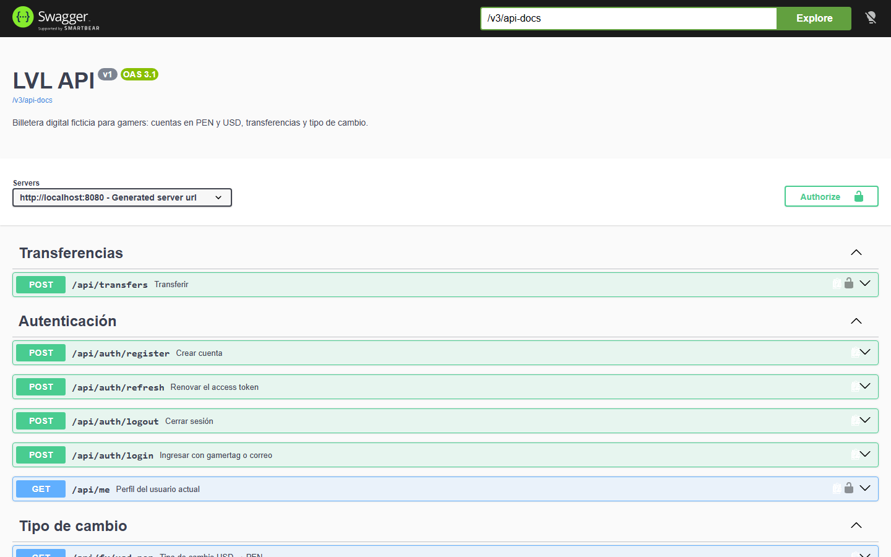
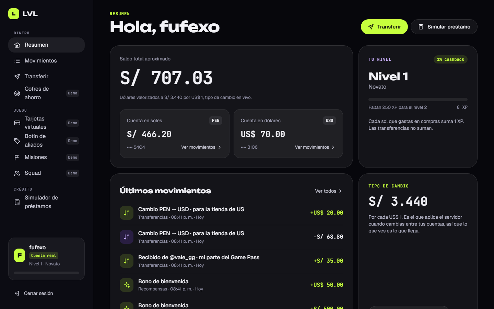
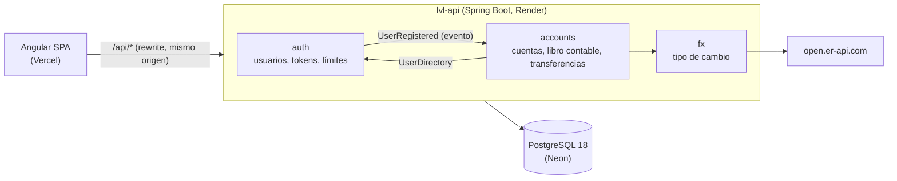
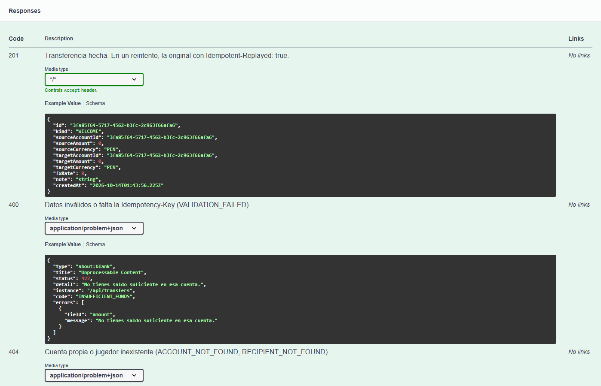

# LVL API — Backend de la billetera digital para gamers

[](https://github.com/Fufexo/lvl-api/actions/workflows/ci.yml)


API REST de **[LVL](https://github.com/Fufexo/lvl-wallet)**, una billetera digital ficticia para gamers en Perú: registro e ingreso con sesiones seguras, cuentas en soles y dólares, transferencias entre cuentas propias (con tipo de cambio en vivo) o a otros jugadores, y un historial respaldado por un **libro contable de partida doble**.

**API en vivo → [lvl-api.onrender.com/swagger-ui.html](https://lvl-api.onrender.com/swagger-ui.html)** · **App → [lvl-wallet.vercel.app/ingresar](https://lvl-wallet.vercel.app/ingresar)** (pestaña *Crear cuenta*)

> Corre en un plan gratuito que se duerme sin tráfico: la primera petición puede tardar hasta un minuto en responder.



La app de Angular consumiendo la API con una cuenta real:



> Proyecto de portafolio. LVL es una marca ficticia; ningún dato es real.

## Qué tiene

- **Registro e ingreso** con gamertag o correo. JWT de acceso de 15 minutos y refresh token rotativo en una cookie `HttpOnly`, con detección de reutilización: si alguien repite un token ya usado, se cierra la sesión en todos los dispositivos de ese ingreso.
- **Cuentas PEN y USD** abiertas al registrarse, con un bono de bienvenida de práctica.
- **Transferencias** entre cuentas propias con cambio de moneda, o a otro jugador por su gamertag. Son **idempotentes**: un reintento con la misma `Idempotency-Key` devuelve la transferencia original y nunca cobra dos veces.
- **Movimientos** paginados por cursor, del más reciente al más antiguo.
- **Tipo de cambio USD → PEN** desde un proveedor público, en caché por una hora.
- **Protección contra fuerza bruta:** el ingreso se pausa tras varios intentos fallidos y el registro tiene límite por dirección.
- **Errores en formato estándar** (RFC 9457) con un `code` estable y el `field` afectado, para que el front los muestre junto al campo.
- **Documentación interactiva** con Swagger UI, con los códigos de respuesta y errores reales de cada endpoint.

## Pruébala en 1 minuto

Contra la API en vivo, con `curl` (o desde Swagger con *Try it out*):

```bash
API=https://lvl-api.onrender.com

# 1. Crear cuenta: devuelve el access token y deja la cookie del refresh token
curl -s -c cookies.txt -X POST $API/api/auth/register \
  -H 'Content-Type: application/json' \
  -d '{"gamertag":"mi_gamertag","email":"yo@ejemplo.com","password":"una-contraseña-larga"}'

# 2. Ver las cuentas (S/ 500 y US$ 50 de bienvenida)
curl -s $API/api/accounts -H "Authorization: Bearer <accessToken>"

# 3. Cambiar soles a dólares; repetir con la misma clave no vuelve a cobrar
curl -s -X POST $API/api/transfers \
  -H "Authorization: Bearer <accessToken>" \
  -H "Idempotency-Key: $(uuidgen)" \
  -H 'Content-Type: application/json' \
  -d '{"sourceAccountId":"<id PEN>","targetAccountId":"<id USD>","amount":34.40}'
```

## Stack

| | |
|---|---|
| Lenguaje | Java 21 (hilos virtuales) |
| Framework | Spring Boot 4.1: Web MVC, Data JPA, Security, Validation, Actuator |
| Arquitectura | Monolito modular verificado con Spring Modulith |
| Base de datos | PostgreSQL 18, migraciones versionadas con Flyway |
| Seguridad | Spring Security OAuth2 Resource Server (JWT HS256), BCrypt |
| Documentación | springdoc-openapi (OpenAPI 3.1 + Swagger UI), ADRs |
| Tests | JUnit 5, AssertJ, MockMvcTester, Testcontainers |
| Entrega | Docker multi-stage, GitHub Actions, Render (Blueprint) + Neon |

## Arquitectura



Cada módulo es un paquete. Solo lo público de su paquete raíz es su API; lo demás es package-private, y `ModularityTest` falla el build si un módulo usa lo interno de otro o si aparece un ciclo. El front llama a `/api` en su propio dominio y Vercel lo reenvía a Render, así que la cookie de sesión es de primera parte y no hace falta CORS.

## Decisiones técnicas

Cada decisión importante tiene su registro (ADR) con las alternativas evaluadas:

- [ADR-0001: Monolito modular con Spring Modulith](docs/adr/0001-monolito-modular.md)
- [ADR-0002: Libro contable de partida doble con bloqueo pesimista](docs/adr/0002-libro-contable.md)
- [ADR-0003: JWT de acceso en memoria y refresh token rotativo en cookie](docs/adr/0003-autenticacion.md)

En resumen:

- **El dinero nunca se crea ni se pierde.** Cada operación genera asientos que suman cero por moneda. Los montos se guardan en céntimos (`bigint`), nunca en `double`, y el cambio de moneda redondea al par (*half-even*).
- **Sin carreras.** Las cuentas de una operación se bloquean (`SELECT … FOR UPDATE`) en orden fijo antes de leer saldos, y la base de datos rechaza saldos negativos aunque el código fallara.
- **Nunca se mueve dinero con un tipo de cambio inventado.** Si el proveedor no respondió nunca, la API muestra un valor de referencia pero rechaza los cambios de moneda (503) hasta tener un tipo real.
- **Contra la fuerza bruta.** Tras 5 contraseñas fallidas para un mismo usuario, el ingreso se pausa 15 minutos (429). Las contraseñas de más de 72 bytes se rechazan, porque BCrypt ignoraría el resto.
- **El login no revela qué usuarios existen:** responde lo mismo, y tarda lo mismo, si el gamertag no existe o si la contraseña es incorrecta.
- **Recursos ajenos responden 404**, no 403: la cuenta de otro jugador simplemente no existe para ti.
- **Ids UUID v7:** ordenados por tiempo (índices compactos) y no adivinables.
- **Observabilidad.** Logs en JSON (ECS) en producción, aviso de cada reutilización de refresh token y de cada error inesperado, que al cliente le llega sin detalles internos. Health check en `/actuator/health`.
- **Configuración validada al arrancar:** sin `LVL_JWT_SECRET` de al menos 32 caracteres, la API no levanta.

## Endpoints

| Método | Ruta | Descripción |
|---|---|---|
| `POST` | `/api/auth/register` | Crear cuenta (abre PEN y USD con bono) |
| `POST` | `/api/auth/login` | Ingresar con gamertag o correo |
| `POST` | `/api/auth/refresh` | Renovar el access token (rota la cookie) |
| `POST` | `/api/auth/logout` | Cerrar sesión |
| `GET` | `/api/me` | Perfil actual |
| `GET` | `/api/accounts` | Cuentas y saldos |
| `GET` | `/api/accounts/{id}/movements` | Movimientos (`?limit=&cursor=`) |
| `POST` | `/api/transfers` | Transferir (requiere `Idempotency-Key`) |
| `GET` | `/api/fx/usd-pen` | Tipo de cambio (público) |
| `GET` | `/actuator/health` | Estado del servicio |

Cada endpoint documenta en Swagger sus respuestas reales, incluidos los errores:



## Calidad

- **40 tests** que corren en cada push en GitHub Actions:
  - **Unitarios:** conversión de montos, cambio de moneda con redondeo, balance de asientos y UUID v7.
  - **Módulos:** Spring Modulith verifica los límites y genera los diagramas en `target/spring-modulith-docs`.
  - **Integración** contra un Postgres 18 real (Testcontainers), a través de HTTP:
    - registro con bono, gamertag único sin importar mayúsculas, errores por campo y contraseñas demasiado largas;
    - login que no revela qué usuarios existen y pausa tras intentos fallidos;
    - rotación del refresh token, revocación al reutilizarlo y logout;
    - transferencias propias con cambio de moneda y entre jugadores;
    - cambio rechazado si el tipo de cambio no es real, fondos insuficientes, reintentos idempotentes, cuentas ajenas y paginación por cursor;
    - **20 transferencias simultáneas** que nunca dejan la cuenta en negativo;
    - después de cada operación, el invariante *por moneda el libro suma cero y cada saldo coincide con sus asientos*.
- La imagen Docker se construye en el CI, y Render solo despliega los commits que pasaron todos los checks.

## Estructura

```
src/main/java/com/fufexo/lvl/
├── shared/      # montos, monedas, UUID v7, errores RFC 9457, entidad base
├── auth/        # usuarios, registro, login, JWT, refresh tokens, límites de intentos
│                  API pública: UserDirectory, UserRegistered
├── accounts/    # cuentas, Ledger (partida doble), transferencias, movimientos
└── fx/          # tipo de cambio USD → PEN con caché
src/main/resources/
├── db/migration/            # V1 usuarios y tokens · V2 libro contable
└── application*.yml         # perfiles local, prod y test
docs/adr/                    # registros de decisiones
render.yaml                  # servicio en Render
compose.yaml                 # Postgres local
```

## Correr el proyecto

Requiere **JDK 21** y **Docker** (Docker Desktop abierto en Windows o Mac).

```bash
./mvnw spring-boot:run     # levanta Postgres con Docker Compose y la API en http://localhost:8080
./mvnw verify              # tests unitarios, de módulos e integración (Testcontainers)
```

Luego abre <http://localhost:8080/swagger-ui.html>. Para usarla desde el front, corre [lvl-wallet](https://github.com/Fufexo/lvl-wallet) con `npm start`: su proxy reenvía `/api` a este puerto.

**Con IntelliJ IDEA:** *File → Open*, elige la carpeta del proyecto y ejecuta `LvlApiApplication`. Sin perfil activo se usa `local`, que levanta Postgres con `compose.yaml`.

## Despliegue

| Pieza | Servicio |
|---|---|
| API | **Render**, servicio Docker en plan gratuito (región Ohio), definido en [`render.yaml`](render.yaml) |
| Base de datos | **Neon**, Postgres 18 serverless (AWS us-east-2, la misma zona que la API) |
| Front | **Vercel**, que reenvía `/api/*` a Render |

Render genera `LVL_JWT_SECRET` por su cuenta y solo despliega los commits con el CI en verde. Las migraciones de Flyway corren al arrancar.

| Variable | Descripción |
|---|---|
| `SPRING_PROFILES_ACTIVE` | `prod` (ya definido en la imagen Docker) |
| `DATABASE_URL` | `jdbc:postgresql://<host>/<db>?sslmode=require` |
| `DATABASE_USERNAME` / `DATABASE_PASSWORD` | Credenciales de Postgres (solo en Render, nunca en el repo) |
| `LVL_JWT_SECRET` | Clave HMAC de al menos 32 caracteres aleatorios |

## Próximos pasos

- Tarjetas virtuales, ofertas, misiones, cofres de ahorro y squad con sus reglas validadas en el servidor.
- Tareas programadas: renovar misiones cada semana y vencer ofertas.
- Servicio de notificaciones alimentado por eventos (correo y Web Push).
- Ingreso con Discord.

## Autor

**Fufexo** — [github.com/Fufexo](https://github.com/Fufexo)
