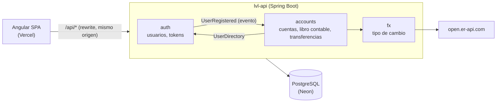

# LVL API — Backend de la billetera digital para gamers

[](https://github.com/Fufexo/lvl-api/actions/workflows/ci.yml)

API REST de [LVL](https://github.com/Fufexo/lvl-wallet), una billetera digital ficticia para gamers en Perú. Registro e ingreso con sesiones seguras, cuentas en soles y dólares, transferencias entre cuentas propias (con tipo de cambio en vivo) o a otros jugadores, y un historial de movimientos respaldado por un libro contable de partida doble.

> Proyecto de portafolio. LVL es una marca ficticia; ningún dato es real.

## Qué tiene

- **Registro e ingreso** con gamertag o correo. JWT de acceso de corta duración y refresh token rotativo en una cookie `HttpOnly`, con detección de reutilización: si alguien repite un token ya usado, se cierra la sesión en todos los dispositivos de ese ingreso.
- **Cuentas PEN y USD** abiertas al registrarse, con bono de bienvenida.
- **Transferencias** entre cuentas propias con conversión de moneda, o a otro jugador por su gamertag. Son idempotentes: un reintento con la misma `Idempotency-Key` nunca cobra dos veces.
- **Movimientos** paginados por cursor, del más reciente al más antiguo.
- **Tipo de cambio USD → PEN** desde un proveedor público, en caché. Si el proveedor cae, se usa el último valor conocido.
- **Errores en formato estándar** (RFC 9457) con un `code` estable y el `field` afectado, para mostrarlos junto al campo del formulario.
- **Documentación interactiva** con Swagger UI en `/swagger-ui.html`.

## Stack

| | |
|---|---|
| Lenguaje | Java 21 |
| Framework | Spring Boot 4.1 (Web MVC, Data JPA, Security, Validation, Actuator) |
| Arquitectura | Monolito modular verificado con Spring Modulith |
| Base de datos | PostgreSQL 17, migraciones con Flyway |
| Seguridad | Spring Security OAuth2 Resource Server (JWT HS256), BCrypt |
| Documentación | springdoc-openapi (OpenAPI 3 + Swagger UI) |
| Tests | JUnit 5, AssertJ, MockMvcTester, Testcontainers |
| Entrega | Docker multi-stage, GitHub Actions |

## Arquitectura



Cada módulo es un paquete. Solo lo público de su paquete raíz es su API; lo demás es package-private, y `ModularityTest` falla el build si un módulo usa lo interno de otro.

## Decisiones técnicas

Cada decisión importante tiene su registro (ADR) con las alternativas evaluadas:

- [ADR-0001: Monolito modular con Spring Modulith](docs/adr/0001-monolito-modular.md)
- [ADR-0002: Libro contable de partida doble con bloqueo pesimista](docs/adr/0002-libro-contable.md)
- [ADR-0003: JWT de acceso en memoria y refresh token rotativo en cookie](docs/adr/0003-autenticacion.md)

En resumen:

- **El dinero nunca se crea ni se pierde.** Cada operación genera asientos que suman cero por moneda. Los montos se guardan en céntimos (`bigint`), nunca en `double`, y el cambio de moneda redondea al par (*half-even*).
- **Sin carreras.** Las cuentas de una operación se bloquean (`SELECT … FOR UPDATE`) en orden fijo antes de leer saldos, y la base de datos rechaza saldos negativos aunque el código fallara.
- **Ids UUID v7:** ordenados por tiempo (índices compactos) y no adivinables.
- **Hilos virtuales** de Java 21 para atender peticiones.
- **Configuración validada al arrancar:** sin `LVL_JWT_SECRET` de al menos 32 caracteres, la API no levanta.

## Endpoints

| Método | Ruta | Descripción |
|---|---|---|
| `POST` | `/api/auth/register` | Crear cuenta (abre PEN y USD con bono) |
| `POST` | `/api/auth/login` | Ingresar con gamertag o correo |
| `POST` | `/api/auth/refresh` | Renovar el access token (rota la cookie) |
| `POST` | `/api/auth/logout` | Cerrar sesión |
| `GET` | `/api/me` | Perfil actual |
| `GET` | `/api/accounts` | Cuentas y saldos |
| `GET` | `/api/accounts/{id}/movements` | Movimientos (`?limit=&cursor=`) |
| `POST` | `/api/transfers` | Transferir (requiere `Idempotency-Key`) |
| `GET` | `/api/fx/usd-pen` | Tipo de cambio (público) |
| `GET` | `/actuator/health` | Estado del servicio |

Ejemplo de error:

```json
{
  "status": 422,
  "detail": "No tienes saldo suficiente en esa cuenta.",
  "code": "INSUFFICIENT_FUNDS",
  "errors": [{ "field": "amount", "message": "No tienes saldo suficiente en esa cuenta." }]
}
```

## Correr el proyecto

Requiere **JDK 21** y **Docker** (Docker Desktop en Windows o Mac).

```bash
./mvnw spring-boot:run     # levanta Postgres con Docker Compose y la API en http://localhost:8080
./mvnw verify              # tests unitarios, de módulos e integración (Testcontainers)
```

Luego abre <http://localhost:8080/swagger-ui.html>.

**Con IntelliJ IDEA:** *File → Open* y elige la carpeta del proyecto. IntelliJ detecta el `pom.xml`. Ejecuta `LvlApiApplication`: sin perfil activo se usa `local`, que levanta Postgres con `compose.yaml`.

### Variables en producción

| Variable | Descripción |
|---|---|
| `SPRING_PROFILES_ACTIVE` | `prod` (ya definido en la imagen Docker) |
| `DATABASE_URL` | `jdbc:postgresql://<host>/<db>?sslmode=require` |
| `DATABASE_USERNAME` / `DATABASE_PASSWORD` | Credenciales de Postgres |
| `LVL_JWT_SECRET` | Clave HMAC de al menos 32 caracteres aleatorios |

## Tests

- **Unitarios:** conversión de montos, cambio de moneda con redondeo, balance de asientos y UUID v7.
- **Módulos:** Spring Modulith verifica los límites entre módulos y genera los diagramas en `target/spring-modulith-docs`.
- **Integración** contra Postgres real (Testcontainers) a través de HTTP:
  - registro con bono, unicidad del gamertag sin importar mayúsculas y errores por campo;
  - login sin revelar qué usuarios existen;
  - rotación del refresh token, revocación al reutilizarlo y logout;
  - transferencias propias con cambio de moneda y transferencias entre jugadores;
  - fondos insuficientes, reintentos idempotentes, intentos sobre cuentas ajenas y paginación por cursor;
  - 20 transferencias simultáneas que nunca dejan la cuenta en negativo;
  - después de cada operación, el invariante "por moneda el libro suma cero y cada saldo coincide con sus asientos".

## Próximos pasos

- Despliegue en Render + Neon y conexión con el frontend.
- Tarjetas virtuales, ofertas, misiones y cofres de ahorro.
- Límite de intentos de login e ingreso con Discord.
- Notificaciones por eventos: correo y Web Push.

## Autor

**Fufexo** — [github.com/Fufexo](https://github.com/Fufexo)
